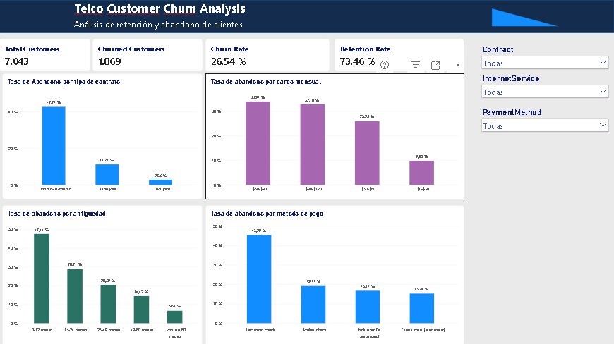

# Telco Customer Churn Analysis

Análisis del abandono de clientes en una empresa de telecomunicaciones, con limpieza y validación de datos en Python y un dashboard interactivo en Power BI.

**Pregunta de negocio:** ¿qué características de los clientes se asocian con una mayor tasa de abandono y qué segmentos conviene investigar para mejorar la retención?

---

## Dashboard

**Dashboard de Power BI:** [https://app.powerbi.com/links/q65pl588sJ?ctid=3374819b-3f7f-4153-ab6a-fd4afd7b386c&pbi_source=linkShare].

## Dashboard Preview



El dashboard incluye cuatro KPIs —clientes totales, clientes que abandonaron, tasa de abandono y tasa de retención— y cuatro gráficos para comparar el abandono por tipo de contrato, antigüedad, rango de cargos mensuales y método de pago. Los segmentadores de contrato, método de pago y servicio de internet permiten explorar distintos segmentos de clientes.

---

## Hallazgos principales

| Hallazgo | Resultado |
|---|---:|
| Clientes analizados | **7.043** |
| Clientes que abandonaron | **1.869** |
| Tasa general de abandono | **26,54 %** |
| Tasa de retención | **73,46 %** |
| Abandono con contrato mensual (*Month-to-month*) | **42,71 %** |
| Abandono con contrato de un año (*One year*) | **11,27 %** |
| Abandono con contrato de dos años (*Two year*) | **2,83 %** |
| Abandono en clientes con 0–12 meses de antigüedad | **47,44 %** |
| Abandono en clientes con más de 60 meses de antigüedad | **6,61 %** |
| Abandono con pago mediante *Electronic check* | **45,29 %** |
| Abandono con pago mediante tarjeta de crédito automática | **15,24 %** |

### Conclusión: contrato y antigüedad

La tasa de abandono es más alta entre los clientes con contratos mensuales (**42,71 %**) que entre quienes tienen contratos de uno o dos años (**11,27 %** y **2,83 %**, respectivamente).

También se observa una asociación entre antigüedad y abandono: la tasa pasa del **47,44 %** en clientes con 0–12 meses a **6,61 %** en clientes con más de 60 meses.

Estos patrones permiten identificar segmentos prioritarios para un análisis posterior de retención. Sin embargo, las diferencias observadas no demuestran por sí solas que el tipo de contrato o la antigüedad causen el abandono.

### Conclusión: método de pago

Los clientes que utilizan *Electronic check* presentan una tasa de abandono del **45,29 %**, frente al **15,24 %** de quienes utilizan tarjeta de crédito con pago automático.

La diferencia es de aproximadamente **30,05 puntos porcentuales**. Conviene investigar si este patrón está relacionado con otras características, como el tipo de contrato o los servicios contratados, antes de proponer cambios en los métodos de pago.

### Cargos mensuales

El promedio de cargos mensuales es mayor entre los clientes que abandonaron:

| Grupo | Promedio mensual | Mediana mensual |
|---|---:|---:|
| Clientes que permanecen (*No churn*) | **$61,27** | **$64,43** |
| Clientes que abandonaron (*Churn*) | **$74,44** | **$79,65** |

La diferencia entre los promedios es de **$13,17 mensuales**. Esto muestra una asociación entre cargos mensuales más altos y abandono, pero no permite concluir que un precio más alto sea por sí solo la causa.

---

## Dataset

**Telco Customer Churn:** conjunto de datos de clientes de telecomunicaciones utilizado para estudiar el abandono.

El archivo original contiene **7.043 registros y 21 columnas**, entre ellas identificador del cliente, servicios contratados, tipo de contrato, antigüedad, cargos mensuales, cargos totales y variable de abandono (`Churn`).

### Decisiones de limpieza

- Se creó una copia de trabajo del conjunto de datos para conservar el archivo original.
- Se eliminaron espacios en blanco de la columna `TotalCharges` y se convirtió a formato numérico.
- Se identificaron **11 valores vacíos** en `TotalCharges`. Los 11 correspondían a clientes con `tenure = 0`; se imputaron con `0`, conservando todos los registros.
- Se comprobó que no hubiera filas duplicadas ni identificadores de cliente duplicados.
- Se crearon las variables derivadas `TenureGroup` y `MonthlyChargesGroup` para analizar el abandono por rangos.
- Se exportó el conjunto limpio a CSV para utilizarlo en Power BI.

**Nota sobre la imputación:** asignar cero a los cargos totales de esos 11 registros es una decisión de preparación de datos basada en su antigüedad igual a cero. Conviene documentarla como supuesto de limpieza, no como una confirmación independiente de los cargos reales.

---

## Estructura del proyecto

```text
churn_analysis/
├── data/
│   ├── raw/
│   │   └── WA_Fn-UseC_-Telco-Customer-Churn.csv
│   └── processed/
│       └── telco_churn_clean.csv
├── notebooks/
│   └── 01_eda_customer_churn.ipynb
├── dashboards/
│   └── Telco_Customer_Churn_Analysis.pbix
├── images/
│   └── dashboard_preview.png
└── README.md
```

El CSV de `data/processed/` se genera a partir del notebook. Si el repositorio se publica en GitHub, se puede decidir si incluirlo o regenerarlo durante la ejecución; el archivo original debe compartirse únicamente respetando sus condiciones de uso.

---

## Proceso de análisis

El proyecto se desarrolló en tres etapas:

**1. Limpieza y preparación en Python**

Se inspeccionaron las dimensiones y los tipos de datos, se revisaron valores vacíos y duplicados, se convirtió `TotalCharges` a formato numérico y se crearon grupos de antigüedad y cargos mensuales.

**2. Análisis exploratorio de datos (EDA)**

Se calculó la tasa general de abandono y se comparó por tipo de contrato, antigüedad, cargos mensuales y método de pago. También se examinaron diferencias entre grupos para identificar patrones relevantes.

**3. Dashboard en Power BI**

Se importó el CSV limpio, se crearon medidas DAX para clientes totales, clientes que abandonaron, tasa de abandono y tasa de retención, y se construyeron tarjetas KPI, gráficos de columnas y segmentadores interactivos.

---

## Cómo reproducirlo

### 1. Preparar el entorno de Python

Se necesita Python y las librerías utilizadas en el notebook.

```bash
py -m venv .venv
.venv\Scripts\activate
py -m pip install pandas numpy matplotlib scikit-learn jupyter
```

### 2. Ejecutar el notebook

Desde la carpeta principal del proyecto:

```bash
jupyter notebook
```

Abre `notebooks/01_eda_customer_churn.ipynb` y ejecuta las celdas en orden.

El notebook utiliza el CSV original ubicado en `data/raw/` y genera el archivo limpio en `data/processed/`.

### 3. Abrir el dashboard

Abre `dashboards/Telco_Customer_Churn_Analysis.pbix` con Power BI Desktop. Si la ruta del CSV cambió, actualiza la fuente de datos para apuntar a `data/processed/telco_churn_clean.csv`.

---

## Valores de control

Utiliza estos valores para comprobar que los resultados de Power BI coincidan con el análisis:

| Indicador | Valor esperado |
|---|---:|
| Total Customers | 7.043 |
| Churned Customers | 1.869 |
| Churn Rate | 26,54 % |
| Retention Rate | 73,46 % |

Otros valores de referencia:

- `Month-to-month`: churn de **42,71 %**.
- `One year`: churn de **11,27 %**.
- `Two year`: churn de **2,83 %**.
- `Electronic check`: churn de **45,29 %**.

---

## Limitaciones

- El análisis es descriptivo: identifica asociaciones, pero no demuestra causalidad.
- Las diferencias entre grupos pueden estar relacionadas con otras variables, como servicios contratados, cargos mensuales o antigüedad.
- La imputación de los 11 valores vacíos de `TotalCharges` a cero debe considerarse un supuesto de limpieza.
- El proyecto no incluye todavía un modelo predictivo validado ni una evaluación de su capacidad para anticipar abandonos.
- Las recomendaciones de retención deben validarse con análisis adicionales antes de implementarse en un entorno real.

---

**Autor:** Guillermo Adrianza · Ingeniero en Sistemas
